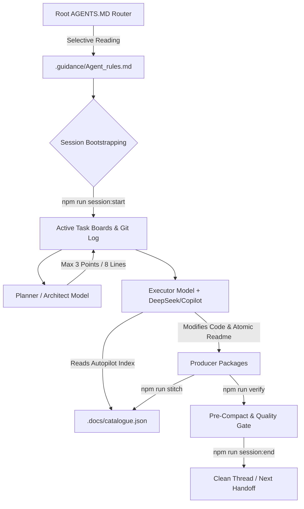

agentic-spec-harness/
├── bin/
│   └── create-harness.mjs    # Skrip CLI generator interaktif (dari draf sebelumnya)
├── docs/
│   └── ARCHITECTURE.md       # Dokumen blueprint rinci (dari rangkuman kita sebelumnya)
├── .gitignore
├── LICENSE                   # Gunakan lisensi MIT
├── package.json              # Siap dipublikasikan sebagai CLI tool / npx
└── README.md                 # Halaman depan portofolio (draf lengkap di bawah)


# Agentic Spec Harness (ASH)

**A lightweight, zero-dependency Spec-Driven Development (SDD) & Multi-Agent Orchestration framework for monorepos and multi-project codebases.**

Designed to eliminate LLM context bloat, prevent cross-agent deadlocks, and optimize token costs by routing tasks across high-reasoning models, cost-efficient coding models, and deterministic Node.js CLI rituals.

---

## The Problem (Real-World Case Study)

While refactoring a complex 5-project monorepo (UI Library, Showcase Docs, Consumer App, CLI Automation, and Server Orchestrator) across long-running sessions (>12 days), standard AI coding workflows hit severe bottlenecks:

1. **Context Obesity ("Reading Tax")**: Agents burned thousands of tokens scanning directories before writing a single line of code.
2. **Cross-Agent Friction & Deadlocks**: Switching between different AI providers (Codex, GitHub Copilot, DeepSeek, Cline) caused state conflicts, duplicate work, or infinite tool-calling loops.
3. **Documentation Drift**: Component specs quickly fell out of sync during rapid refactoring.

## The Solution: File-System Memory & Deterministic Rituals

Instead of relying on bloated chat histories, **Agentic Spec Harness** treats the **file system as the single source of truth** and offloads procedural thinking to deterministic Node.js CLI scripts.

### Architecture & Handoff Flow



### Core Pillars

* **Progressive Disclosure (`AGENTS.MD` & `.guidance`)**: A hierarchical router system ensuring agents only load rules relevant to their active task.
* **Atomic Documentation & Autopilot Index (`catalogue.json`)**: Every component maintains a local `readme.md`. A CLI stitcher compiles all atomic specs into a single `catalogue.json` so consumer apps can discover and use components without blind directory traversal.
* **High-Signal Task Boards with TTL Lock**: Active tasks are constrained to **max 3 points / 8 lines** with a Time-To-Live (TTL) expiry rule, preventing context rot and allowing seamless overrides across agents or team members.
* **Deterministic CLI Rituals (`scripts/`)**: Session bootstrapping, spec compilation, line-count validation, and build verification are handled by zero-dependency `.mjs` scripts rather than LLM reasoning.
* **Cost-to-Intelligence Model Routing**: Built-in `work_agreement.md` protocols to pair expensive reasoning models (architecture/review) with low-cost or free-tier models (execution/docs).

---

## Quick Start

Scaffold a complete multi-agent harness into any new or existing workspace using Node.js (`>=18.0.0`):

```bash
git clone https://github.com<your-username>/agentic-spec-harness.git
cd <your-target-workspace>
node /path/to/agentic-spec-harness/bin/create-harness.mjs
```

The interactive CLI will tailor the workspace topology, task board mode (Solo vs. Team), TTL locks, and producer-consumer catalog mappings based on your project timeline and manpower.

---

## Generated Workspace Layout

```text
workspace/
├── AGENTS.MD                 # Global router & cross-project access contract
├── .clinerules               # Override rules to prevent aggressive directory scanning
├── .guidance/
│   ├── Agent_rules.md        # Selective reading & pre-compact protocols
│   ├── work_agreement.md     # Multi-model routing & TTL override rules
│   ├── Rules.md              # Technical guardrails
│   └── boards/               # High-signal task state (max 3 points / 8 lines)
├── .docs/
│   ├── catalogue.json        # Auto-compiled component/module autopilot index
│   └── session-notes.txt     # Pre-compact knowledge archive
└── scripts/
    ├── readme.md             # Self-documenting CLI registry
    ├── session.mjs           # Session start/end & board line-count validator
    └── stitch-catalogue.mjs  # Atomic readme compiler
```

---

## License

MIT License — Free to use, modify, and adapt for solo workflows or engineering teams.
