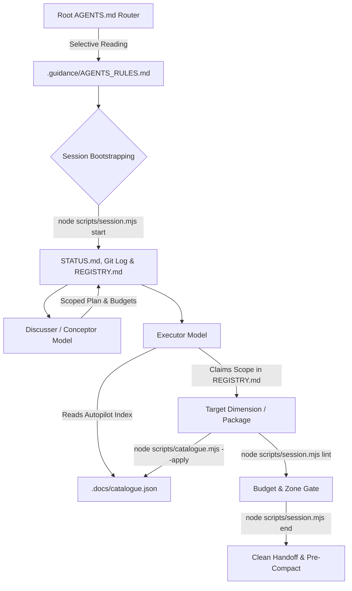

# WARNA

### **W**orkflow **A**rchitecture for **R**outing **N**ative **A**gents

> _Workspace-Agnostic Rules for Navigating Agents — powered by deterministic Work Agreements, Rituals, & Navigation for Agents._

**WARNA** is a lightweight, zero-dependency Spec-Driven Development (SDD) & Multi-Agent Orchestration harness for monorepos and multi-project codebases. Just like blending distinct colors into a cohesive spectrum, WARNA orchestrates diverse AI models—combining high-reasoning architects, cost-efficient coding agents, and free-tier utilities—into a single, token-optimized workflow without context rot or cross-agent deadlocks.

---

## Why WARNA?

When refactoring complex multi-project codebases across long-running sessions, standard AI coding workflows hit predictable bottlenecks:

1. **Context Obesity ("Reading Tax"):** Agents burn thousands of tokens blindly scanning directories before writing a single line of code.
2. **Cross-Agent Friction & Deadlocks:** Switching between different AI providers (Codex, Copilot, Gemini, Claude, DeepSeek, Cline) causes write-scope collisions, duplicate work, or unprompted execution loops.
3. **Documentation & Spec Drift:** Component contracts fall out of sync during rapid refactors, while stray markdown notes pollute `docs/` and agent memory files.
4. **Heavy Ritual Overhead on Small Tasks:** Treating a quick 1–2 file tweak with the same ceremony as a multi-day architectural refactor slows down daily momentum.

**WARNA's Solution:** Treat the **file system as the single source of truth** and offload procedural rituals, line-budget validation, and catalogue compilation to deterministic, zero-dependency Node.js CLI scripts (`.mjs`).

---

## Core Pillars

- **Progressive Disclosure (`AGENTS.md` & `.guidance/`):** A hierarchical router system ensuring agents load only the rules and dimension routes relevant to their active scope.
- **Role-Locked Collaboration (`Discusser` · `Conceptor` · `Executor`):** Prevents agents from jumping into premature execution or asking _"Should I start?"_ during pure brainstorming or high-level sketching.
- **High-Signal State & TTL Scope Registry (`REGISTRY.md`):** Active write scopes are claimed before editing with a Time-To-Live (TTL) expiry rule, while `STATUS.md` and `PLAN.md` enforce strict line and card budgets to eliminate context rot.
- **Micro-Scope Mode (1–2 File Fast Path):** Focused edits or impact checks on 1–2 files bypass heavy board ceremony while preserving core safety boundaries and concrete impact analysis.
- **Atomic Specs & Autopilot Index (`catalogue.json`):** Each component or module maintains a local `README.md`. `scripts/catalogue.mjs` compiles all atomic specs into a single machine-readable `.docs/catalogue.json` without duplicating prose.
- **Deterministic CLI Rituals (`scripts/`):** Session bootstrapping (`start`), three-line checkpoints (`cp`), line/zone auditing (`lint`), and pre-compact handoffs (`end`) run via zero-dependency `.mjs` scripts rather than LLM guesswork.
- **Cost-to-Intelligence Model Routing:** Pairs high-reasoning models (architecture, review, impact analysis) with cost-efficient or free-tier models (scoped execution, documentation).

---

## Architecture & Handoff Flow



## Generator & Workspace Layout (aio-kit)

WARNA is scaffolded via `CreateWarna.class.ts (AioWarna)`, which reads `warna.manifest.json`, resolves `{{TOKEN}}` placeholders, and applies conflict-safe overrideConditions.

## CLI Source Layout (aio-kit)

```txt
aio-kit/src/
├── class/
│   └── CreateWarna.class.ts               # Generator class (AioWarna): reads manifest, injects {{ }} tokens, applies overrideConditions
└── lib/
    └── templates/
        └── WARNA/
            ├── AGENTS.md                  # Root router + Roles + Zone Locks + Cleanup
            ├── .guidance/
            │   ├── AGENTS_RULES.md        # Hard operational rules, budgets, code style & handoff protocol
            │   ├── mandatory/
            │   │   ├── ARCHITECTURE.md
            │   │   ├── CODING_PRINCIPLES.md
            │   │   ├── DESIGN_PHILOSOPHY.md
            │   │   ├── DOCUMENTATION.md
            │   │   ├── LANGUAGE.md
            │   │   └── WORKING_STYLE.md
            │   └── project/
            │       ├── REGISTRY.md        # Live write-scope claim registry (.guidance/project/REGISTRY.md)
            │       ├── STATUS.md          # Bounded session logbook
            │       ├── README.md          # Read-only project flow & entry map
            │       └── PLAN.md            # Bounded active queue & stage tracker
            ├── scripts/
            │   ├── session.mjs            # Ritual runner (start · cp · end · lint)
            │   └── catalogue.mjs          # Atomic README → catalogue.json compiler
            ├── warna.manifest.json        # Default manifest seed
            └── warna.md                   # Reference guide

```

## Target Consumer Project Layout

When initialized inside a consumer repository (`AioWarna.init`), templates are mapped cleanly into the project root:

```txt
./
  ├── AGENTS.md                              # Root router (with {{ }} tokens resolved)
  ├── .guidance/
  │   ├── AGENTS_RULES.md                    # Core governance & style rules
  │   ├── manifest.json                      # Project manifest (name = target folder basename)
  │   ├── warna.md                           # Framework reference
  │   ├── mandatory/*                        # Baseline engineering conventions
  │   └── project/
  │       ├── PLAN.md                        # Stateful — preserved unless --force
  │       ├── README.md                      # Stateful — preserved unless --force
  │       ├── REGISTRY.md                    # Stateful — preserved unless --force
  │       └── STATUS.md                      # Stateful — preserved unless --force
  ├── scripts/
  │   ├── session.mjs                        # Manifest-driven session & lint runner
  │   └── catalogue.mjs                      # Manifest-driven catalogue compiler
  ├── .docs/                                 # Compiled machine-readable indexes (e.g., catalogue.json)
  ├── .temp/                                 # Ephemeral scratch/script logs
  ├── .archieves/                            # Read-only historical archive
  └── docs/                                  # Read-only curated documentation
```

## Initialization Sequence (`AioWarna.init`)

1. **Scaffold Zones**: Create the target root along with governance and zone directories defined under `governance.*` in the manifest.
2. **Seed Manifest**: Generate `./.guidance/manifest.json` (setting `name` to the target directory's basename) if it does not already exist.
3. **Render Templates**: Copy and interpolate `{{TOKEN}}` placeholders across all mapped template files.
4. **Conflict Protection**: Existing files win by default (use `--force` to overwrite). Stateful project files (`REGISTRY.md`, `STATUS.md`, `README.md`, `PLAN.md`) are never overwritten without explicit `--force`.

## CLI Rituals & Commands

All scripts are zero-dependency Node.js ES modules driven by `.guidance/manifest.json`:

| Command                              | Purpose                                                                                                                                                |
| ------------------------------------ | ------------------------------------------------------------------------------------------------------------------------------------------------------ |
| `node scripts/session.mjs start`     | **STEP 0:** Inspects git status, recent commits, `STATUS.md` cards, live claims in `REGISTRY.md`, and budget warnings.                                 |
| `node scripts/session.mjs cp`        | **Checkpoint (`CP-3`):** Generates a strict 3-line pointer block (`CHANGED`, `PROVED`, `NEXT`) for session memory.                                     |
| `node scripts/session.mjs lint`      | **Budget & Zone Gate:** Validates line limits on `STATUS.md`, `PLAN.md`, and `TASK.md`, and checks for unauthorized edits in `docs/` or `.archieves/`. |
| `node scripts/session.mjs end`       | **Pre-Compact Handoff:** Guides cleanup, commit verification, claim release, and structured handoff reporting (~60k / ~80k / ~100k token thresholds).  |
| `node scripts/catalogue.mjs`         | **Dry Run:** Scans component/module `README.md` files and reports bundle size and drift status.                                                        |
| `node scripts/catalogue.mjs --apply` | **Compile Index:** Writes the compiled JSON index to `.docs/catalogue.json`.                                                                           |
| `node scripts/catalogue.mjs --check` | **CI / Verification Gate:** Exits with code `1` if the compiled catalogue has drifted from source READMEs.                                             |

## Zone Governance & File Placement

| Path                            | Policy                | Purpose                                                                |
| ------------------------------- | --------------------- | ---------------------------------------------------------------------- |
| `.guidance/project/STATUS.md`   | **Bounded Write**     | Current session logbook and return point (strict line & card cap).     |
| `.guidance/project/PLAN.md`     | **Bounded Write**     | Active queue and stage tracking (strict line & item cap).              |
| `.guidance/project/REGISTRY.md` | **Claim Table Only**  | Live write-scope lock table with TTL expiry; release rows on wrap-up.  |
| `TASK.md` (local dimension)     | **Ephemeral Spec**    | Single-pass task context; **must be deleted** upon completion.         |
| `.docs/`                        | **Generated Output**  | Machine-readable indexes compiled by scripts (e.g., `catalogue.json`). |
| `.temp/`                        | **Ephemeral Scratch** | Temporary logs and script outputs; purge during cleanup.               |
| `docs/` & `.archieves/`         | **STRICT READ-ONLY**  | Never dump session notes, logs, or unrequested `.md` files here.       |
